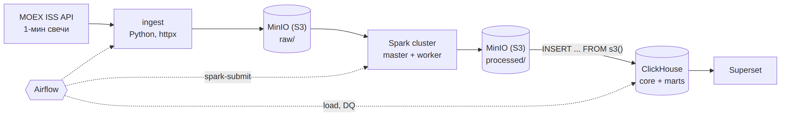

# MOEX ETL Pipeline

Проект в разработке.

Пайплайн минутных свечей акций Московской биржи. Данные идут из MOEX ISS API
в S3 (MinIO), обрабатываются в Spark, хранятся в ClickHouse и показываются
в Superset. Оркестрация Airflow, всё в docker compose.



- что и в каком объёме грузим: [docs/scope.md](docs/scope.md)
- слои данных и вопросы дашборда: [docs/architecture.md](docs/architecture.md)

## Запуск

Нужны Docker, Docker Compose, make и curl. Под стек стоит выделить Docker
хотя бы 12 ГБ памяти.

```bash
cp .env.example .env
make gen-keys     # скопировать вывод в .env, заполнить пароли
make              # jar-ы для S3, сборка, запуск, миграции ClickHouse, бакет
```

| Сервис | Адрес |
|---|---|
| Airflow | http://localhost:8080 |
| Superset | http://localhost:8088 |
| ClickHouse (Play UI) | http://localhost:8123/play |
| MinIO (консоль) | http://localhost:9001 |
| Spark master UI | http://localhost:8081 |

## Структура

```
dags/          DAG-и Airflow
ingest/        клиент MOEX ISS и запись raw в S3
spark_jobs/    PySpark-трансформации
clickhouse/    DDL, прогоняется `make ch-migrate`
dq/            проверки качества данных
superset/      образ и конфиг Superset
config/        справочник бумаг и секторов
docker/        init-скрипты контейнеров
scripts/       служебные скрипты (создание бакета)
jars/          hadoop-aws для Spark, скачивается `make jars`, в git не хранится
docs/          scope, архитектура, диаграммы
tests/         pytest
```
